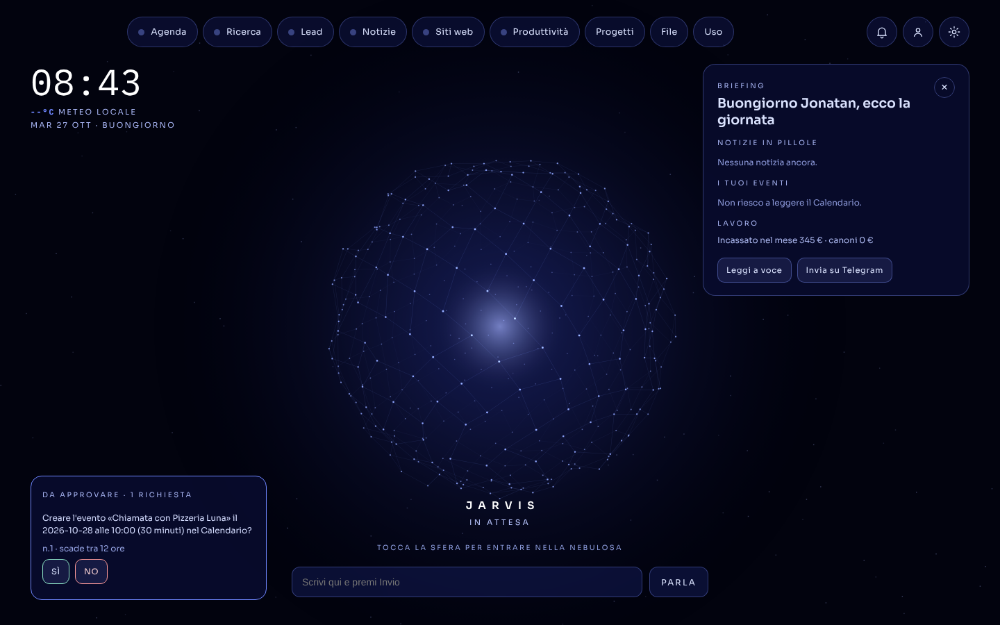
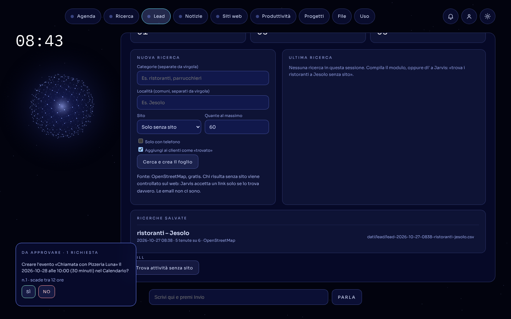
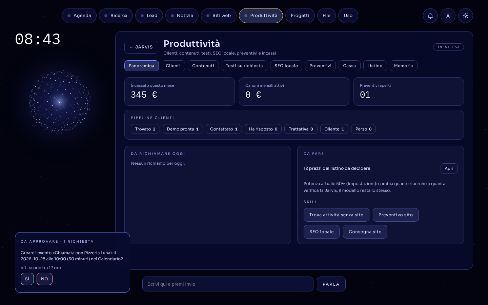
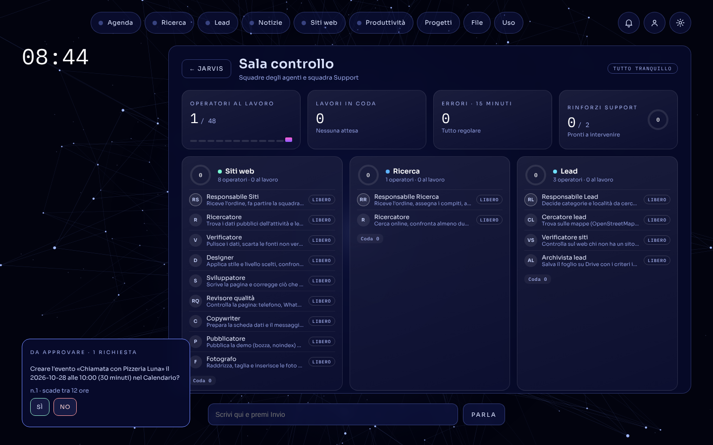
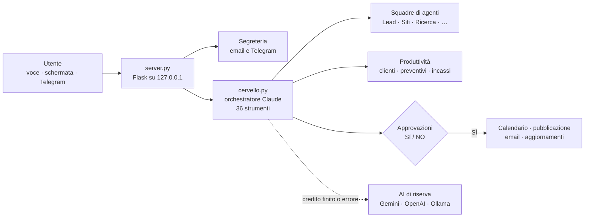

# Jarvis

**Assistente AI personale per chi lavora con le attività locali: trova i lead, li segue fino al cliente e tiene d'occhio tutto il resto.**

> **In English:** Jarvis is a voice-and-chat AI assistant that runs locally on a Mac. A Claude orchestrator with 36 tools
> and 13 agent teams finds local businesses without a website (OpenStreetMap + web verification), tracks them through a
> sales pipeline, drafts demo websites, quotes and messages, and asks for a human YES on Telegram before any critical action.
> Python · Flask · Claude API (tool use, sub-agents, prompt caching) · fallback to Gemini/OpenAI/Ollama · pytest · GitHub Actions.



*Tutti gli screenshot usano dati inventati, creati con `crea_dati_demo.py`.*

## Cosa fa

| Reparto | In breve |
|---|---|
| **Lead** | Cerca attività per categoria e comune su OpenStreetMap (Google Places se c'è la chiave). Per chi risulta senza sito controlla sul web se ne ha uno, e accetta un link solo se lo trova davvero. Salva un Foglio Google con caselle di scelta e aggiunge le attività ai clienti. |
| **Produttività** | Pipeline dei clienti (trovato → demo → contattato → cliente), richiami automatici, listino, preventivi, abbonamenti, incassi e margine per cliente rispetto al costo dell'AI. |
| **Siti web** | Per un'attività senza sito prepara una demo one-page con i soli dati pubblici verificati, la controlla con un Revisore qualità e scrive il messaggio per il titolare. Non lo invia mai da solo. |
| **Ricerca e notizie** | Ricerca web con più fonti citate; notizie del giorno con link controllati; briefing del mattino. |
| **Segreteria** | Email Gmail e Telegram: le bozze partono solo dopo «invia». |
| **Sala controllo** | 13 squadre di agenti con responsabile e operatori, e una squadra Support che interviene quando un lavoro fallisce. |

| Lead | Clienti |
|---|---|
|  |  |
| **Produttività** | **Sala controllo** |
|  |  |

## Come è fatto



- **Orchestratore**: Claude con *tool use*. Sceglie lo strumento, delega ai sotto-agenti con ricerca web e usa il *prompt caching* (parte fissa del prompt in cache, ora e skill nella parte variabile).
- **Skill**: procedure scritte in `skills/*/SKILL.md`, attivabili a voce o con un clic.
- **AI di riserva** (`ai.py`): se Claude non risponde, Jarvis passa da solo a Gemini, OpenAI, Ollama o OpenRouter, avvisa su Telegram e rispetta un tetto di spesa mensile.
- **Dati**: file JSON scritti in modo atomico in `dati/`, che resta solo sul Mac.

## Sicurezza

Jarvis agisce nel mondo vero (calendario, email, pubblicazione), quindi i limiti sono nel codice, non solo nel prompt:

- **Approvazioni** (`approvazioni.py`): le azioni critiche aspettano un SÌ, su Telegram o sulla schermata. Il modello non può approvare da solo.
- **Zona sacra** (`zona_sacra.py`): i file di sicurezza si cambiano solo con il SÌ più un codice di 6 cifre mandato su Telegram. Il codice vale 5 minuti, una sola volta, e si salva solo come impronta.
- **Server chiuso**: ascolta solo su `127.0.0.1` e rifiuta richieste da altri siti aperti nel browser. Le demo dei siti girano in una sandbox (CSP).
- **Mai dati inventati**: un link vale solo se compare nei risultati di ricerca; i dati mancanti diventano «[da confermare]».

## Provarlo

Serve un Mac con Python 3.11 o più recente e una chiave dell'API di Anthropic.

```bash
git clone https://github.com/Umano17/Jarviss.git ~/jarvis-demo && cd ~/jarvis-demo
python3 -m venv venv && source venv/bin/activate
pip install -r requirements.txt
cp .env.esempio .env              # scrivi ANTHROPIC_API_KEY e NOME_UTENTE
cp segreteria/config.esempio.py segreteria/config.py   # legge le chiavi dal .env
python crea_dati_demo.py          # clienti, lead e note inventati
python server.py                  # poi apri http://127.0.0.1:8765
```

Telegram, Gmail e Drive sono facoltativi: senza, le approvazioni compaiono solo sulla schermata. Le istruzioni complete sono in [`CLAUDE.md`](CLAUDE.md).

## Qualità

```bash
ruff check .          # stile ed errori comuni (regole in pyproject.toml)
python -m pytest      # 28 test, senza internet: mappe, Google e Telegram sono finti
```

GitHub Actions esegue entrambi a ogni push. I test coprono Lead, approvazioni, zona sacra e dati demo. Hanno già trovato un bug vero: il filtro della zona sacra non riconosceva `.env` né `.gitignore`.

## Tecnologie

Python · Flask · Claude API (tool use, sotto-agenti, ricerca web, prompt caching) · Gemini / OpenAI / Ollama / OpenRouter come riserva · OpenStreetMap Overpass · Google Places, Gmail, Drive e Sheets API · Telegram Bot API · AppleScript (Calendario) · Netlify · HTML/CSS/JS senza framework · pytest · ruff · GitHub Actions

## Il progetto

Costruito da Jonatan in un mese (ottobre 2026), passando dalla versione 1.0 alla 3.9, imparando facendo. La storia, le scelte e cosa ho imparato sono nel [caso studio](docs/caso-studio.md).
