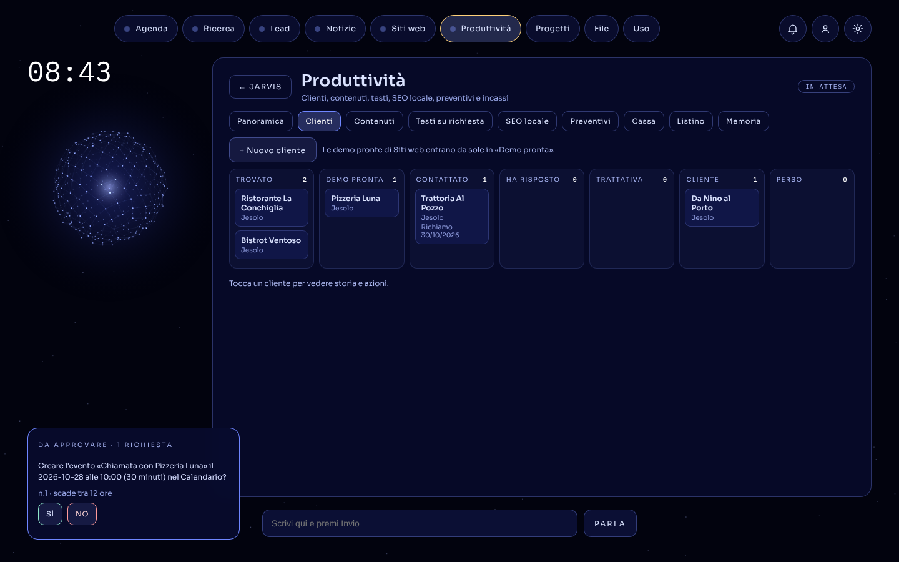

# Caso studio: Jarvis

**Un assistente AI che trova attività locali senza sito, le segue fino al contratto e chiede il permesso prima di fare qualcosa di importante.**

Progetto personale, ottobre 2026 · Python, Flask, Claude API · [codice](../README.md)

---

## Il problema

Chi offre siti web alle attività locali passa la maggior parte del tempo in lavoro ripetitivo, non nel lavoro vero:

- trovare chi **non ha ancora un sito**: le mappe dicono spesso il falso, e un controllo a mano richiede minuti per ogni attività;
- ricordarsi **chi è stato contattato e quando richiamarlo**;
- preparare demo, preventivi e messaggi **ogni volta da zero**.

Volevo un assistente che facesse questo lavoro al posto mio, ma senza mai agire alle mie spalle: niente email, pubblicazioni o eventi in calendario senza il mio sì.

## La soluzione

Jarvis gira sul mio Mac e si usa a voce, dalla schermata web o da Telegram. Un orchestratore (Claude) sceglie fra 36 strumenti e delega a 13 squadre di agenti specializzati.

1. **Lead**: «trova i ristoranti a Jesolo senza sito». Jarvis interroga OpenStreetMap e controlla sul web ogni attività che risulta senza sito. Accetta un link solo se lo trova nei risultati o se apre la pagina e ci legge il nome dell'attività. Il risultato è un Foglio Google con caselle di scelta, e le attività entrano fra i clienti.
2. **Pipeline**: ogni cliente avanza da *trovato* a *cliente*. I richiami si programmano da soli, preventivi e incassi si collegano al costo dell'AI spesa per quel cliente, così vedo il margine vero.
3. **Demo e messaggi**: per un'attività scelta Jarvis prepara una demo one-page con i soli dati pubblici verificati, la fa controllare da un Revisore e scrive il messaggio per il titolare. Il messaggio resta una bozza.
4. **Approvazioni**: le azioni che toccano il mondo esterno arrivano su Telegram con i pulsanti SÌ / NO. Per i file di sicurezza serve anche un codice di 6 cifre.

## Scelte e ostacoli

| Ostacolo | Scelta |
|---|---|
| La fatturazione di Google Places non era attivabile | Fonte principale **OpenStreetMap** (gratis), con server di riserva se è sovraccarico. Google Places resta una possibilità, usata solo se c'è la chiave. |
| OpenStreetMap non sa se un'attività ha davvero un sito | Un **Verificatore** con ricerca web, che non si fida del modello: il link deve comparire nei risultati o la pagina deve contenere il nome. |
| Un'AI che agisce può sbagliare in modo irreversibile | **Approvazioni** nel codice, non nel prompt: il modello non ha nessuno strumento per approvare da solo. |
| Jarvis può aggiornare se stesso da GitHub | **Zona sacra**: un aggiornamento che tocca i file di sicurezza chiede anche un codice monouso; chiavi e credenziali non possono mai arrivare da un aggiornamento. |
| Se finisce il credito di Claude, Jarvis si ferma | **AI di riserva** con passaggio automatico a Gemini, OpenAI o Ollama e un tetto di spesa mensile. È successo davvero durante la prova finale, e Jarvis ha continuato a rispondere. |
| Un sito qualsiasi aperto nel browser poteva chiamare l'API locale | Il server accetta solo richieste dalla propria schermata e ascolta solo su `127.0.0.1`. |

## Qualità

- **28 test** con pytest, senza internet: mappe, Google e Telegram sono simulati. **ruff** per lo stile. **GitHub Actions** li esegue a ogni push.
- I test hanno trovato un **bug vero** nel filtro di sicurezza: `lstrip("./")` toglieva *tutti* i punti iniziali, quindi `.env` diventava `env` e passava il controllo. La correzione è una riga (`removeprefix`), protetta da un test.
- **Versione demo**: `crea_dati_demo.py` genera clienti e lead inventati usando le funzioni vere di Jarvis. Così si può mostrare tutto senza esporre dati reali.

## Tecnologie

Python · Flask · Claude API (tool use, sotto-agenti, ricerca web, prompt caching) · Gemini / OpenAI / Ollama / OpenRouter · OpenStreetMap Overpass · Google Gmail, Drive e Sheets API · Telegram Bot API · AppleScript · Netlify · HTML/CSS/JS senza framework · pytest · ruff · GitHub Actions

## Cosa ho imparato

- **Un'AI utile ha bisogno di limiti scritti nel codice.** Le regole nel prompt si possono aggirare, una funzione che aspetta il SÌ no.
- **Non fidarsi dei dati, nemmeno di quelli del modello.** Il Verificatore esiste perché sia le mappe sia l'AI sbagliano sui siti web.
- **I test trovano quello che le prove a mano non vedono.** Il bug della zona sacra era lì dalla versione 3.7.
- **Git salva i progetti.** Una cartella `skills` sostituita invece che unita ha cancellato 13 skill, recuperate in pochi minuti dalla storia.
- **Finire conta più che aggiungere.** Dopo un mese di funzioni nuove (dalla versione 1.0 alla 3.9) ho congelato il perimetro: trading, YouTube e altre idee sono usciti in progetti separati, e Jarvis è diventato un prodotto con uno scopo chiaro.
